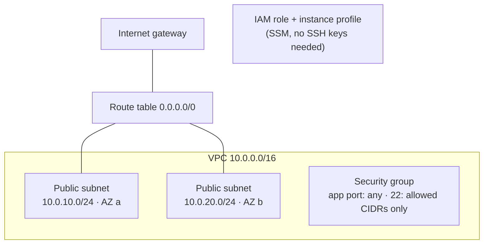

# AWS network baseline with Terraform

A small, secure-by-default AWS foundation: VPC, public subnets across two AZs, internet gateway and routing, a security group, and an IAM role for instances. Meant as a starting point for an environment, not a full landing zone.



## Security decisions

- **No credentials in code.** The provider reads them from the environment (`AWS_PROFILE`, SSO, or an assumed role).
- **SSH is never open to the internet.** `ssh_allowed_cidrs` is required, and a validation rule rejects `0.0.0.0/0`.
- **SSM instead of SSH.** Instances get `AmazonSSMManagedInstanceCore`, so Session Manager can replace SSH entirely.
- **No public IPs by default** on the subnets. You assign them only where needed.
- **Everything is tagged** (`Project`, `Environment`, `ManagedBy`) through provider default tags.
- State and `*.tfvars` are git-ignored.

## Files

| File | Contents |
|---|---|
| [`versions.tf`](versions.tf) | Terraform/provider versions, provider config, default tags |
| [`variables.tf`](variables.tf) | inputs with validation |
| [`main.tf`](main.tf) | VPC, subnets, IGW, routes, security group, IAM |
| [`outputs.tf`](outputs.tf) | IDs other stacks need |
| [`terraform.tfvars.example`](terraform.tfvars.example) | example inputs |

## Usage

```bash
cp terraform.tfvars.example terraform.tfvars   # set your project name and SSH range
export AWS_PROFILE=dev

terraform init
terraform plan
terraform apply
```

Remove a single resource without touching the rest:

```bash
terraform destroy -target=aws_route_table_association.public
```

Inspect state:

```bash
terraform state list
terraform state show aws_vpc.main
```

## Next steps for production

- Remote state in S3 with DynamoDB locking
- Private subnets with NAT gateway for workloads
- VPC Flow Logs to CloudWatch or S3
- `tfsec` / `checkov` in CI before `apply`
